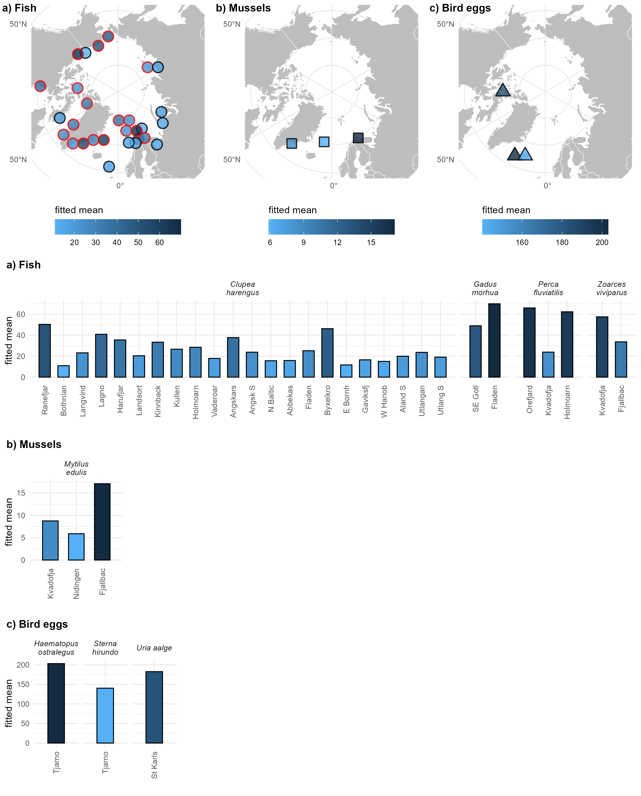
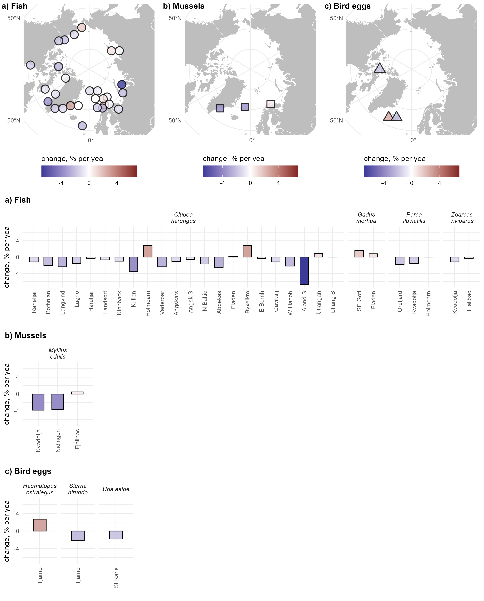

## The idea

HARSAT keeps data and statistic results in one assessment object. This can be saved as an `.rds` file.

HARSAT has build in functions for tables and plots, but once you have the assessment object you can also make your own outputs in R, for example using ggplot2:

- no need to rerun HARSAT
- no need to have HARSAT installed
- a few lines of R for each output

Example on PAHs in blue mussel that we will work with: <https://github.com/annelaerkes/harsat-postprocessing>

::: notes
Today's data: PAHs in blue mussel from the Swedish marine programme, three stations. Everything from one file, PAH.rds. Go to github site an follow the code.
:::

## Change these lines for your own data

```{r}
my_file      <- "data/PAH.rds"
my_series    <- "FJBA PYR Mytilus edulis SB"   # one name from names(res$assessment)
my_y_label   <- "Pyrene, ug/kg dry weight"
my_substance <- "PYR"
my_species   <- "Mytilus edulis"
```

<br>

Everything after this reads from these lines.

The packages used are `dplyr` and `ggplot2`, plus `sf`, `rnaturalearth` and `rnaturalearthdata` for the map.

```{r}
#| echo: false
library(dplyr)
library(ggplot2)
dir.create("output/tables", recursive = TRUE, showWarnings = FALSE)
```

## Step 1: open the object

```{r}
res <- readRDS(my_file)

names(res)
```

```{r}
names(res$assessment)[1:3]
```

```{r}
series <- res$assessment[[my_series]]

names(series)
```

::: notes
Each element of res$assessment is the result for one time series. Its name is station, substance, species and tissue. You can look at all of this in RStudio without knowing anything else about HARSAT.
:::

## What we need from one series

| In the object | What it is | Scale |
|:------|:----------|:---|
| `series$annualIndex` | annual means | **log** |
| `series$pred` | fitted trend and confidence band | **log** |
| `series$data` | individual samples | original |
| `series$summary` | one row of results: trends, mean, thresholds | original |

<br>

`exp()` brings log-scale values back to the original scale.

Biological variables are not always on the log scale: for those, remove `exp()`.

```{r}
#| echo: false
means   <- series$annualIndex
trend   <- series$pred
samples <- series$data
limit   <- series$summary$EQS
```

::: notes
This is the one thing to remember. If your plot looks wrong by a large factor, check the scale first.
:::

## Step 2: the annual means

```{r}
#| output-location: column
#| fig-width: 5
#| fig-height: 4.8
means <- series$annualIndex

plot_1 <- ggplot() +
  geom_point(data = means,
             aes(year, exp(index)),
             size = 2)
plot_1
```

## Add the fitted trend

```{r}
#| output-location: column
#| fig-width: 5
#| fig-height: 4.8
#| code-line-numbers: "4-10"
trend <- series$pred

plot_2 <- plot_1 +
  geom_ribbon(data = trend,
              aes(year,
                  ymin = exp(ci.lower),
                  ymax = exp(ci.upper)),
              alpha = 0.25) +
  geom_line(data = trend,
            aes(year, exp(fit)))
plot_2
```

## Add the individual samples

```{r}
#| output-location: column
#| fig-width: 5
#| fig-height: 4.8
#| code-line-numbers: "4-6"
samples <- series$data

plot_3 <- plot_2 +
  geom_point(data = samples,
             aes(year, concentration),
             size = 0.75)
plot_3
```

::: notes
Concentration is on the original scale, so there is no exp() here.
:::

## Add the threshold and labels

```{r}
#| output-location: column
#| fig-width: 5
#| fig-height: 4.8
#| code-line-numbers: "4-8"
limit <- series$summary$EQS

plot_4 <- plot_3 +
  geom_hline(yintercept = limit,
             linetype = "dashed") +
  labs(title = my_series, x = NULL,
       y = my_y_label) +
  theme_classic(base_size = 15)
plot_4
```

## Step 3: put all results in one table

Each series has its own one-row summary. Put them together, then add what each series is and where it is.

```{r}
summaries <- res$assessment |>
  lapply(function(x) x$summary) |>
  bind_rows(.id = "series")

all_series <- res$timeSeries |>
  mutate(series = rownames(res$timeSeries)) |>
  left_join(res$stations, by = "station_code") |>
  left_join(summaries, by = "series")

write.csv(all_series, "output/tables/all_series.csv", row.names = FALSE, na = "")
```

`all_series` now has `r nrow(all_series)` rows, one per time series.

::: notes
This table is the most useful single thing in the talk. Once you have it you can filter it, sort it, open the CSV in Excel, or plot from it.
:::

## Choose the rows and columns you want

```{r}
#| output: false
one_substance <- filter(all_series, determinand == my_substance, species == my_species)

my_table <- one_substance |>
  arrange(desc(station_latitude)) |>
  transmute(Station = station_name,
            Years = paste(firstYearAll, lastyear, sep = "-"),
            `Recent change, %/year` = recent_change,
            `p recent` = round(p_recent_change, 3),
            `Mean last year` = round(meanLY, 2),
            `Upper CL` = round(clLY, 2),
            Threshold = round(EQS, 1),
            Status = EQSbelow)
```

## The table

```{r}
#| echo: false
knitr::kable(my_table)
```

<br>

Status comes from HARSAT, and it is based on the upper confidence limit (Upper CL), not on the mean.

::: notes
Fjällbacka: the mean is below the threshold, but the upper confidence limit is above it, so the status is "above".
:::

## Step 4: the base map

```{r}
#| output-location: column
#| fig-width: 5.5
#| fig-height: 5
world <- rnaturalearth::ne_countries(
  scale = "medium",
  returnclass = "sf")

base_map <- ggplot(world) +
  geom_sf(colour = "white",
          fill = "grey") +
  coord_sf(xlim = c(8, 25),
           ylim = c(54, 70),
           expand = FALSE) +
  labs(x = NULL, y = NULL) +
  theme_minimal()
base_map
```

::: notes
Change xlim and ylim for your own region. Longitude first, then latitude.
:::

## Add the fitted mean

```{r}
#| output-location: column
#| fig-width: 5.5
#| fig-height: 5
#| code-line-numbers: "2-8"
map_mean <- base_map +
  geom_point(data = one_substance,
             aes(station_longitude,
                 station_latitude,
                 fill = meanLY,
                 colour = EQSbelow),
             shape = 21, size = 5,
             stroke = 1) +
  scale_fill_gradient(low = "#56B1F7",
                      high = "#132B43") +
  scale_colour_manual(
    values = c(above = "red",
               below = "black"),
    na.value = "black") +
  labs(fill = "Mean", colour = "Status")
map_mean
```

::: notes
Fjällbacka: the fitted mean, 63.5, is below the threshold of 100, but the outline is red. HARSAT's status is based on the upper confidence limit, 147, not on the mean.
:::

## Another column, another map

```{r}
#| output-location: column
#| fig-width: 5.5
#| fig-height: 5
#| code-line-numbers: "5"
map_change <- base_map +
  geom_point(data = one_substance,
             aes(station_longitude,
                 station_latitude,
                 fill = recent_change),
             shape = 21, size = 5,
             stroke = 1) +
  scale_fill_gradient2(low = "blue",
                       mid = "white",
                       high = "red") +
  labs(fill = "% per year")
map_change
```

## What would you change?

| To get | Change |
|:----------|:----------------|
| another substance or station | `my_series`, `my_substance`, `my_y_label` |
| another species | `my_species` |
| your own data | `my_file` |
| your own region | `xlim` and `ylim` in the base map |
| another threshold | `EQS` to another name, e.g. `EAC` |
| other columns in the table | the lines inside `transmute()` |

## Optional: the same plot for many series

Copying the code for every series would be a lot of work, so write it once as a function and loop.

```{r}
#| eval: false
plot_one_series <- function(id) {
  series <- res$assessment[[id]]

  ggplot() +
    geom_point(data = series$annualIndex, aes(year, exp(index)), size = 2) +
    geom_point(data = series$data, aes(year, concentration), size = 0.75) +
    labs(title = id, x = NULL)
}

for (id in one_substance$series) {
  ggsave(paste0("output/figs/all_series/", id, ".png"), plot_one_series(id))
}
```

::: {.small}
Shortened for the slide. The full version in `postprocessing_recipes.R` also adds the trend and threshold, when a series has them.
:::

## What these plots leave out

These plots are kept simple. They do not show:

- values below LOQ, which look like ordinary points here
- samples from years that HARSAT left out of the trend fit

The Swedish reporting pipeline has the full report-style figures, with both:

<https://github.com/NRM-MOC/fmcom-annual-report>

::: notes
Always check how your own data looks before using a simplified plot. If a series has many values below LOQ, use the full version.
:::

## Modifying scripts publicly available on github

::: {layout-ncol=2}

{height=300px}

{height=300px}
:::

## HARSAT "extra" postprocessing tools on github

- Norwegian HARSAT ggplot plotting package: <https://github.com/DagHjermann/harsatextras>

- Swedish National reporting pipeline: <https://github.com/NRM-MOC/fmcom-annual-report>

- Change point analysis: <https://github.com/mskoldSU/lmcp>

- Simple ggplot and table example: <https://github.com/annelaerkes/harsat-postprocessing>

Let us know if you have other ideas for outputs that could be made from the HARSAT object or scripts you want to share.